

  

  
  
  

### Hola, soy Hugo 👋

Desarrollador en **Trujillo, Perú**. Hago webs para negocios que viven en Instagram y WhatsApp: hamburgueserías, gimnasios, tiendas de ropa y de relojes. Cada web sale de su marca real (sus fotos, su carta, sus precios) y recibe los pedidos por WhatsApp.

También hago **software para negocios de verdad**. Checa tu Placa nació porque compro y vendo autos y revisaba SUNARP, SAT, papeletas y SOAT en páginas distintas: hice una sola. [TuGym](https://tugym.online) nació en Bulls, un gym que llevaba a sus clientes en un Excel: hoy es un panel para cualquier gym, con la app de sus alumnos.

- 🛠️ Hago la web, el backend y el servidor: lo diseño, lo programo y lo publico yo.
- 🤖 Trabajo con **Claude Code** y vendo las skills que uso en [hugorocha.pe](https://hugorocha.pe).
- 💼 Hoy trabajo en [Pablo](https://usapablo.com).

 

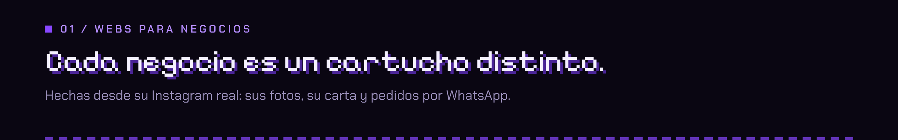

  <a href="https://amantedelasburgers.hugorocha.pe">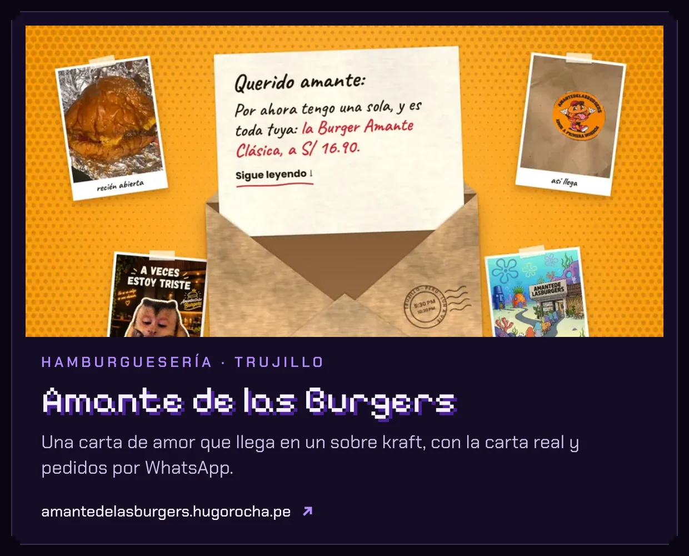</a>
  <a href="https://bullstrainingclub.hugorocha.pe">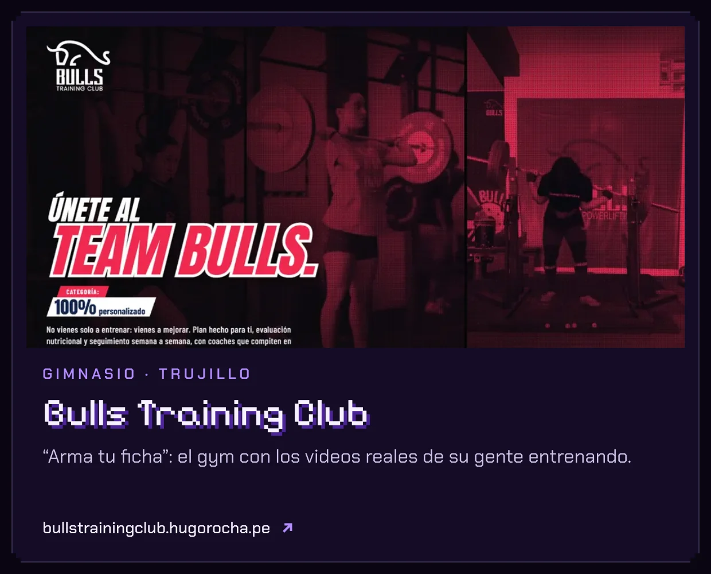</a>
  <a href="https://thundershop.hugorocha.pe">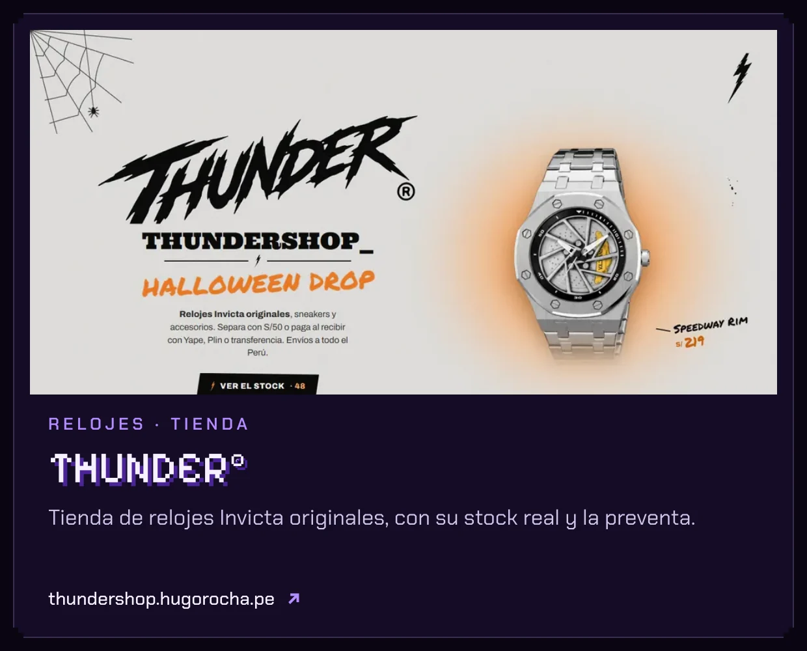</a>
  <a href="https://camiserosperu.hugorocha.pe">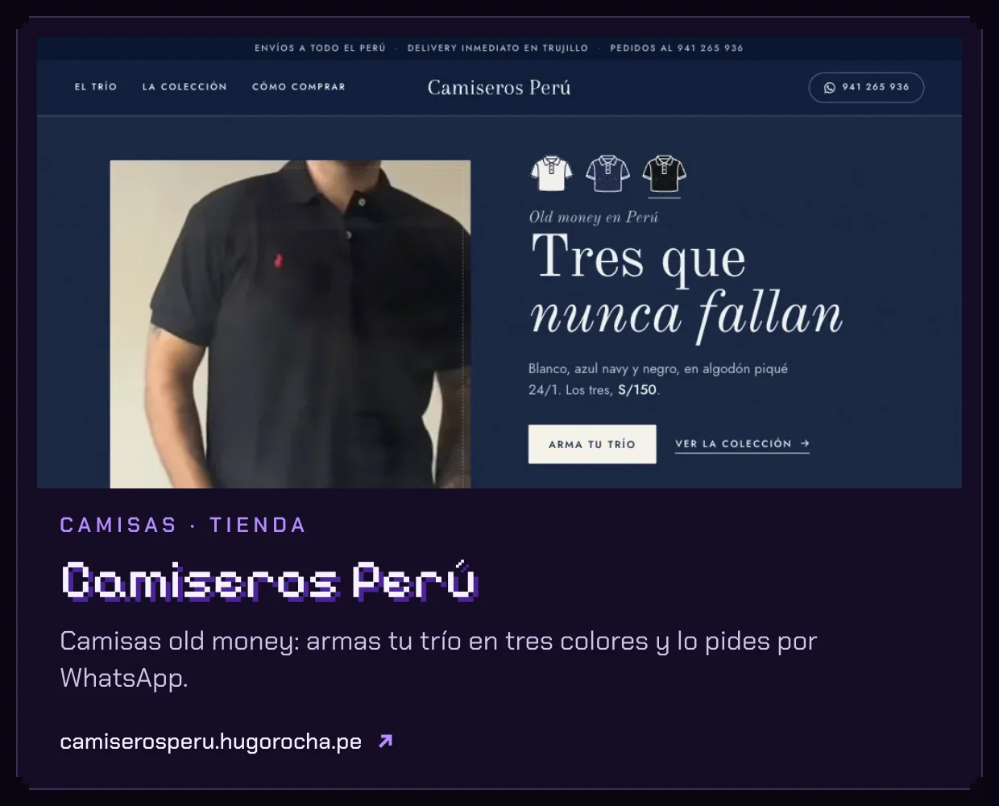</a>
  <a href="https://wavestore.hugorocha.pe">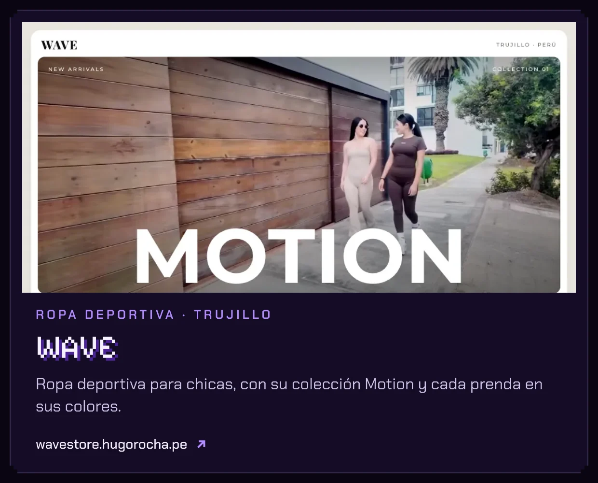</a>
  

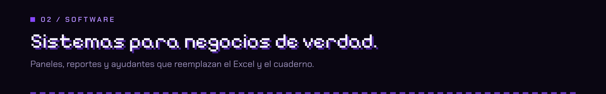

  <a href="https://tugym.online">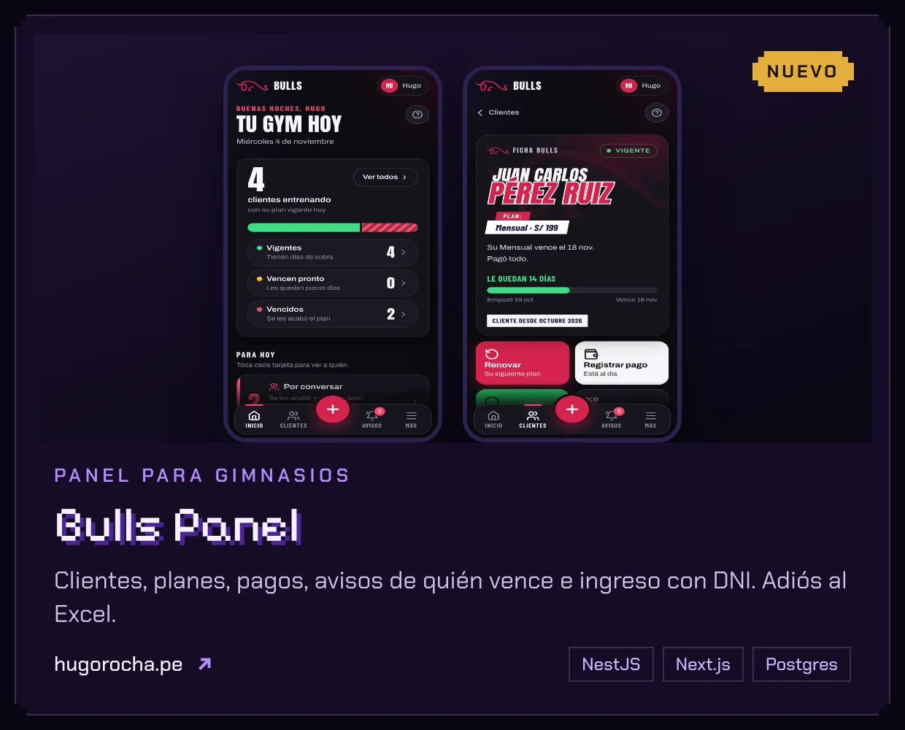</a>
  <a href="https://checatuplaca.com">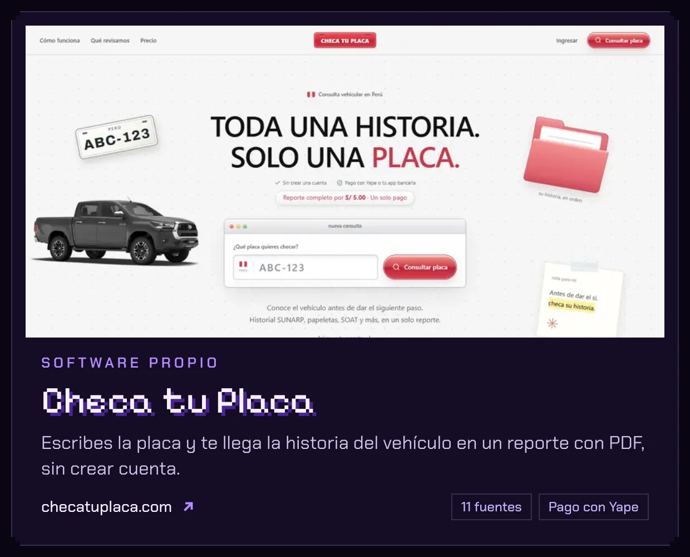</a>
  <a href="https://caserita.lat">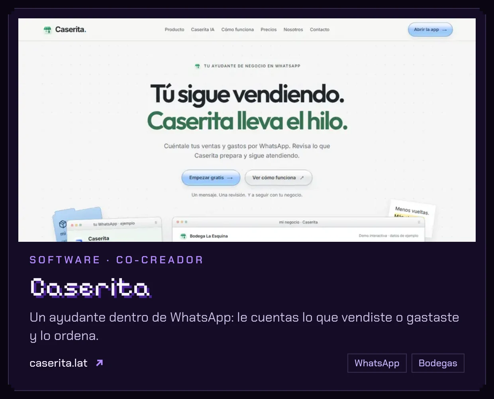</a>

Además: apps móviles en SwiftUI y Kotlin, y herramientas para Mac como <a href="https://github.com/Perezhppr/WarpConsumo">WarpConsumo</a> (código abierto).

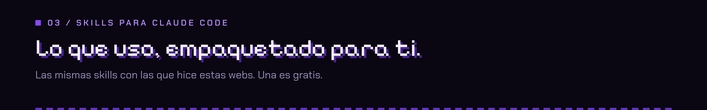

  <a href="https://hugorocha.pe/skills/web-con-concepto">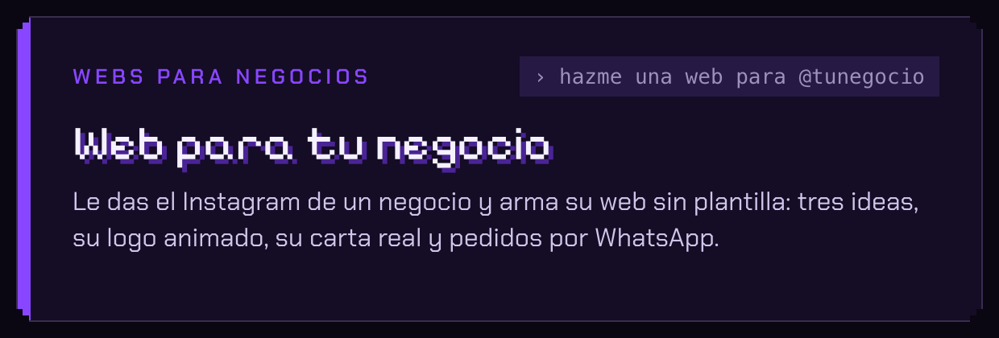</a>
  <a href="https://hugorocha.pe/skills/carrusel-con-gancho">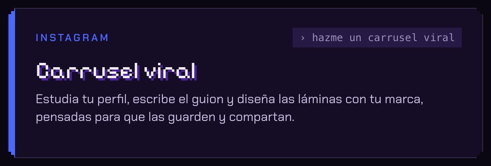</a>
  <a href="https://hugorocha.pe/skills/carrusel-en-movimiento">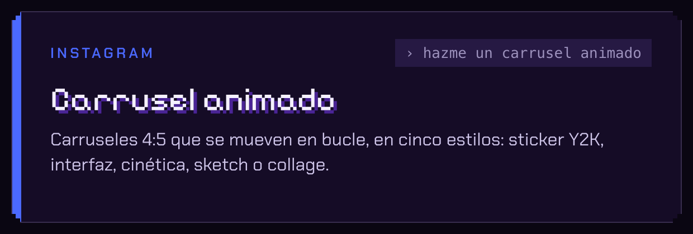</a>
  
  <a href="https://hugorocha.pe/skills/web-en-linea">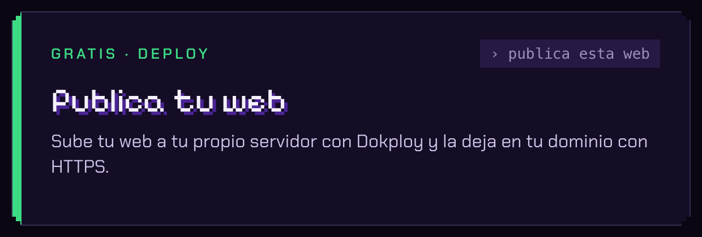</a>

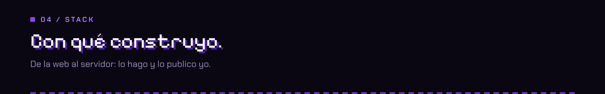

<table align="center">
  <tr>
    <td width="420" align="center" valign="top">
      
01 / WEB
<h3>Webs y paneles</h3>
      

      
HTML · CSS · JavaScript TypeScript · Next.js · GSAP

    </td>
    <td width="420" align="center" valign="top">
      
02 / BACKEND
<h3>Servidor y datos</h3>
      

      
Node.js · NestJS · PostgreSQL Supabase · SQLite

    </td>
  </tr>
  <tr>
    <td width="420" align="center" valign="top">
      
03 / APPS
<h3>Móvil y Mac</h3>
      

      
SwiftUI (iOS y macOS) Kotlin (Android)

    </td>
    <td width="420" align="center" valign="top">
      
04 / PUBLICAR
<h3>Infraestructura</h3>
      

      
Docker · Dokploy · Cloudflare Git · GitHub

    </td>
  </tr>
</table>

 

  <a href="https://wa.me/51957498880?text=Hola%20Hugo%2C%20vi%20tu%20GitHub%20y%20quiero%20una%20web">
    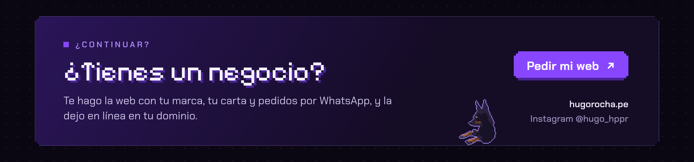
  </a>

